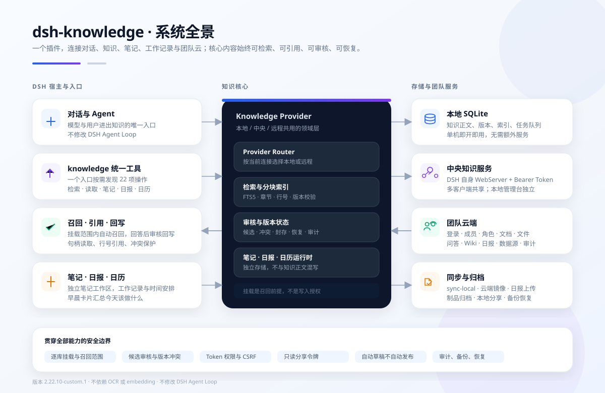
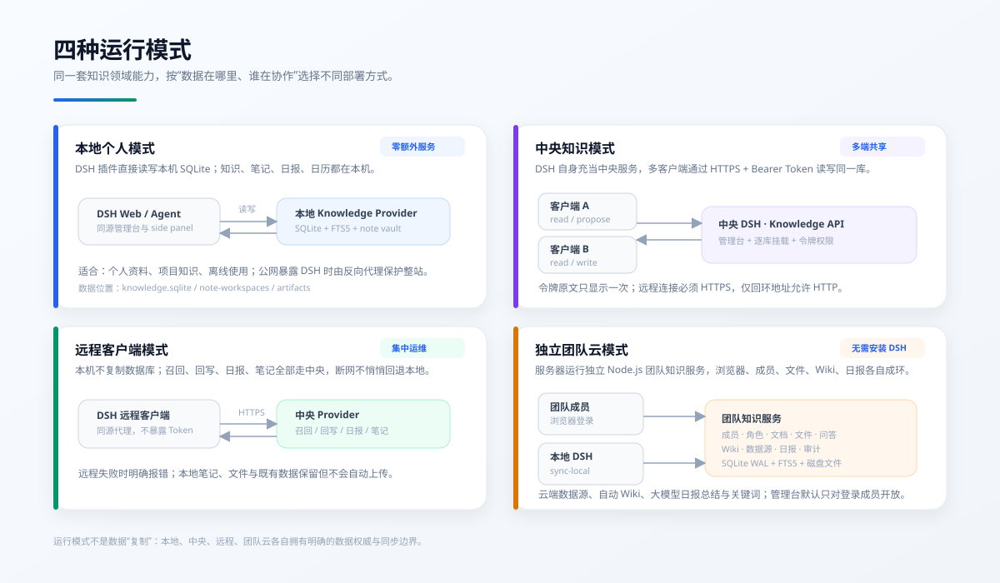
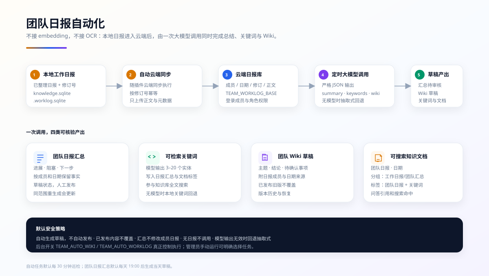

# DSH Knowledge 产品手册

<div align="center">

**把资料、对话、笔记、日报和团队知识，组织成一个可检索、可引用、可审核、可恢复的知识系统。**

`2.22.10-custom.1` · DeepSeek Harness 插件 · 本地与团队云端双形态

</div>



> 本手册面向使用者、团队管理员和部署者。技术细节可继续阅读 [架构说明](./architecture.md)、[使用与配置](./usage.md) 和 [云端部署手册](../cloud/README.md)。

---

## 目录

- [1. 产品定位](#1-产品定位)
- [2. 功能地图](#2-功能地图)
- [3. 系统架构](#3-系统架构)
- [4. 核心流程](#4-核心流程)
- [5. 功能详解](#5-功能详解)
- [6. Agent 工具与 API](#6-agent-工具与-api)
- [7. 权限、数据与安全边界](#7-权限数据与安全边界)
- [8. 部署与运维](#8-部署与运维)
- [9. 当前边界](#9-当前边界)
- [10. 快速开始](#10-快速开始)
- [11. 常见问题](#11-常见问题)

---

## 1. 产品定位

### 1.1 一句话

**DSH Knowledge 是 DSH 的知识底座：**

- 让模型在回答前找到正确的项目资料；
- 让引用能回到原文、章节和行号；
- 让回答后的新知识经过审核再写入；
- 让笔记、工作日报和日程独立存在、统一入口；
- 让团队通过一个独立云端工作台共同维护知识。

### 1.2 解决的问题

| 常见问题 | DSH Knowledge 的答案 |
|---|---|
| 资料散落在 Markdown、PDF、Office、GitHub 和聊天里 | 多格式文件库、知识文档、GitHub/Gitee 数据源统一管理 |
| 模型回答“像知道”，但无法核对 | 检索片段、引用列表、原文回跳、版本和行号 |
| 回答里出现的新知识没人整理 | 回答后独立提取，候选审核后写入 |
| 本地知识和团队知识混在一起 | 本地、中央、远程、团队云四种运行模式明确分离 |
| 笔记和知识库互相干扰 | 独立笔记工作区，默认不参与知识召回 |
| 工作记录只有流水，没有沉淀 | 工作日报自动整理，团队云端汇总为 Wiki、关键词和知识文档 |
| 文档越用越多，找不到、改坏了、撤不回 | 分组、搜索、版本历史、冲突保护、回收站、备份恢复 |

### 1.3 四个设计原则

1. **知识可追溯**：先找到证据，再回答；引用必须能回到来源。
2. **写入有门槛**：模型不直接改写正文；候选、审核、版本和权限分层。
3. **范围先于能力**：挂载决定召回，权限决定读取，确认决定写入。
4. **自动但不失控**：自动 Wiki、自动日报汇总只生成草稿，不自动发布。

---

## 2. 功能地图

### 2.1 四个空间

| 空间 | 核心能力 | 数据位置 |
|---|---|---|
| **知识空间** | 知识库、文档、分组、检索、问答、回写、Wiki、文件 | SQLite + 文件目录 |
| **笔记空间** | 多级目录、Markdown 编辑、历史、附件、分享、外部目录同步 | 笔记工作区 |
| **工作记录** | 工作日报、采集范围、自动整理、日历、目标、早晨卡片 | 独立日报数据库 |
| **团队云端** | 成员、角色、共享文档、文件库、问答、Wiki、数据源、日报汇总 | 独立 Node.js 服务 |

### 2.2 能力清单

```text
知识库 ── 多库 · 分组 · 文档 · 版本 · 回写审核 · 检索 · 引用
笔记   ── 目录 · 编辑器 · 历史 · 附件 · 分享 · 外部目录 · @ 引用
日报   ── 采集 · 补记 · 整理 · 导出 · 历史 · 分享
日历   ── 目标 · 时间块 · 进度 · 结转 · iCal · 回收站
云端   ── 登录 · 邀请 · 角色 · 文件 · 问答 · Wiki · 数据源 · 自动任务
集成   ── DSH 工具 · 知识侧栏 · 早晨卡片 · 腾讯文档 · 制品归档 · 本地分享
```

---

## 3. 系统架构

### 3.1 一张图看懂运行模式



### 3.2 本地个人模式

```text
DSH Web / Agent
      │
      ▼
Knowledge Provider ── SQLite（正文 / 版本 / FTS5 / 索引 / 任务）
      │
      ├── 笔记工作区
      ├── 工作日报数据库
      └── 制品归档 / 文件目录
```

特点：

- 安装后即可使用，不需要额外服务。
- 本地管理台使用同源管理权限，不要求 Bearer Token。
- 适合个人资料、项目知识、离线使用。
- 若 DSH 暴露到公网，应由反向代理保护整个 DSH 站点。

### 3.3 中央知识模式

```text
客户端 A ─┐
客户端 B ─┼── HTTPS + Bearer Token ── 中央 DSH Knowledge API
客户端 C ─┘                              │
                                         ├── 共享 SQLite
                                         ├── 统一笔记工作区
                                         └── 统一工作日报
```

特点：

- 中央 DSH 自身提供管理和 API，不需要额外容器。
- 每台客户端使用独立 Token，可分配 `read`、`propose`、`write`。
- 远程连接必须使用 HTTPS；只有回环地址允许 HTTP 测试。
- 插件通过同源代理访问中央 API，不把 Token 交给浏览器。
- 中央和客户端都需升级到支持统一日报的版本。

### 3.4 远程客户端模式

- 本机不复制中央数据库。
- 召回、回写、日报和笔记均走中央连接。
- 断网时明确报错，不悄悄回退本地。
- 适合统一运维、统一权限、统一备份的团队。

### 3.5 独立团队云模式

```text
浏览器成员 ───────────────┐
                          ├── 团队知识服务（Node.js 24）
本地 DSH ── sync-local ────┘      ├── 成员 / 邀请 / 会话
                                  ├── 文档 / 版本 / 搜索
                                  ├── 文件库 / 解析 / 预览
                                  ├── Wiki / 问答 / 数据源
                                  ├── 团队日报 / 自动任务
                                  └── 审计 / 备份
```

特点：

- 服务器不需要安装完整 DSH。
- 成员通过浏览器登录，管理员生成一次性邀请。
- 角色：管理员、编辑者、阅读者。
- 文档级版本检查，避免多人覆盖。
- 默认只对登录成员开放，不提供匿名分享。
- 与本地 DSH 通过 `cloud/sync-local.mjs` 或插件设置页同步。

### 3.6 代码分层

| 层 | 职责 |
|---|---|
| **DSH 宿主层** | 侧栏入口、设置页、工具注册、聊天引用、会话事件 |
| **接口层** | 统一 `knowledge` 工具、本地管理 API、中央 Bearer API |
| **领域层** | 知识库、文档、候选、挂载、笔记、日报、日历、分享 |
| **存储层** | SQLite、FTS5、文件目录、笔记工作区、日报数据库 |
| **外部层** | 中央 DSH、团队云服务、腾讯文档桥、GitHub/Gitee |
| **同步层** | 本地→云端、云端→镜像、日报上传、增量游标、冲突报告 |

---

## 4. 核心流程

### 4.1 检索与回答

```text
用户问题
   │
   ▼
检查当前会话挂载范围
   │
   ├── 未挂载：不召回、不读取知识正文
   │
   ▼
FTS5 / 结构化分块候选
   │
   ▼
排序、片段、行号、句柄
   │
   ▼
模型回答（证据不足时明确拒答/提示）
   │
   ▼
引用列表 + 原文回跳
```

关键点：

- 挂载只表示“可选”，不表示每次回答都召回。
- 句柄与会话绑定，重启或切换来源后失效；失效时必须重新搜索，不能猜测旧引用。
- 文件搜索与文档搜索在云端统一返回，但引用保持各自来源。

### 4.2 回答后回写

```text
完整回答结束
   │
   ▼
独立提取模型：是否值得长期保存？
   │
   ├── 否：结束
   │
   ▼
目标库 / 重复 / 更新 / 冲突判断
   │
   ▼
候选变更（正文增删、目标文档、置信度）
   │
   ▼
用户审核：通过 / 编辑后通过 / 拒绝
   │
   ▼
事务写入 + 版本 + 审计
```

- 主回答模型不直接写库。
- 候选不会无审核覆盖正文。
- 失败任务进入可重试队列，不阻断下一轮对话。
- 每个知识库可配置特定提取要求。

### 4.3 团队日报自动化



```text
本地已整理日报
   │ 自动同步（按修订号幂等）
   ▼
云端团队日报库
   │ 每天配置时间后
   ▼
一次大模型调用（严格 JSON）
   │
   ├── 团队日报汇总
   ├── 可检索关键词
   ├── 团队 Wiki 草稿
   └── 可搜索的知识文档
          （工作日报/团队汇总 + 关键词标签）
```

自动生成物全部为草稿，不自动发布；成员日报正文不被修改。未配置模型或输出无效时，回退到抽取式汇总、本地关键词和同内容 Wiki。

### 4.4 本地与云端同步

```text
本地知识库 ── push ──▶ 云端知识库
云端知识库 ── pull ──▶ 本地原库（显式拉取）
云端知识库 ── mirror ─▶ 本地“云端·库名”镜像库
本地日报库 ── push ──▶ 云端团队日报
云端团队日报 ── pull ──▶ 终端“团队日报”只读镜像
```

- 未变化内容跳过。
- 重复同步幂等。
- 云端和本地都变化时保留本地并报告冲突。
- 镜像库不会被再次推回云端。
- 映射文件要保留，否则重复推送会新建文档。
- 云端数据丢失时，可用本地镜像回灌。
- 团队日报镜像使用独立知识库「团队日报」，不写入个人日报数据库；成员日报和云端小组汇总自动到达每个终端。
- 云端汇总为权威版本，终端不重复用本地模型生成不同的小组日报。

---

## 5. 功能详解

### 5.1 知识库与文档

- 多知识库创建、编辑、归档、恢复、删除。
- 文档分组、标签、作用域、类型、置信度。
- Markdown 编辑与安全预览。
- 文档版本历史、恢复、冲突保护。
- 文档封存、完成状态。
- 文档批量分组。
- 知识文档只读分享。
- 整个知识库只读分享。
- 制品自动归档到独立知识库。

### 5.2 检索与引用

- SQLite FTS5 全文检索。
- 可丢弃的结构化分块索引：
  - 章节、段落范围；
  - Unicode 偏移、行号；
  - 标题路径、父子章节；
  - 索引版本校验。
- 结果带片段、行号、来源。
- 会话句柄读取。
- 长文档分页，明确截断和 `nextOffset`。
- 引用失效时重新检索。
- 问答引用编号和证据列表。
- 无模型时返回可核对证据，不编造。
- 召回事故记录。

### 5.3 挂载、召回与回写

- 项目挂载和会话覆盖。
- 召回、写入、标签范围。
- 自动召回、最低分、条数和字符预算。
- 会话级知识侧栏。
- 回写候选审核。
- 回写任务队列与重试。
- 本机/知识库/会话模型优先级。
- 全局回写策略：严谨 / 主动。
- 回答超限双倍预算重试。

### 5.4 笔记

- 独立笔记空间，无限嵌套目录。
- Markdown、文本、JSON、YAML、CSV、代码、配置编辑。
- 标题大纲、查找替换、浮动格式菜单。
- 页面历史、逐行差异、恢复旧版。
- 上传、拖放、复制、移动、下载。
- 图片、PDF 就地浏览。
- 笔记文档/目录只读分享。
- 从其他 DSH 导入分享。
- 外部目录自动同步。
- 输入框 `@` 搜索并引用笔记文档和可编辑文件。
- 知识文档关联笔记引用。

### 5.5 工作日报

- 按本机工作目录树选择采集范围。
- 可包含/排除子目录。
- 手动补记、整理、编辑、导出。
- 来源核对、历史版本、只读分享。
- 默认每天 23:30 保底整理，可独立关闭。
- 采集和整理开关独立。
- 无新素材不调用模型。
- 不覆盖人工编辑正文。
- 中央统一日报。
- 远程模式失败明确报错。
- 日报只读工具，不生成/修改。
- 本地日报自动上传云端；云端自动生成小组汇总。
- 各终端通过云端同步拉取独立「团队日报」只读镜像，包含成员日报与小组汇总。
- 团队镜像不写入个人日报数据库；本地已人工修改的镜像文档不会被静默覆盖。

### 5.6 工作日历

- 每日目标 / 实际工作记录。
- 全天或指定时间。
- 标签、项目、优先级、状态。
- 结转：每天 / 工作日。
- 进度补写。
- revision 冲突保护。
- 幂等 requestId。
- 回收站与恢复。
- iCalendar 导出。
- changes 增量接口。

### 5.7 早晨卡片

- 今日摘要。
- 待办数量和完成状态。
- 新增、勾选、删除。
- 工作 / 生活分类。
- 可拖动、双击复位。
- 每分钟刷新。

### 5.8 云端团队知识库

- 成员邮箱 + 密码登录。
- 管理员一次性邀请。
- 三角色权限。
- 文档共同编辑、版本冲突提示。
- 文档搜索、下载、版本记录。
- 任意类型文件库。
- 文件解析、预览、重新解析、状态显示。
- 统一搜索与问答引用。
- Wiki 草稿、发布、版本、恢复。
- GitHub/Gitee 数据源。
- 本地库同步与镜像。
- 团队日报、自动汇总、模型关键词、Wiki 和知识文档。
- 自动任务开关。
- 审计、备份、恢复。

### 5.9 文件解析矩阵

| 格式 | 文本抽取 | 预览 |
|---|---:|---|
| PDF | ✓（文本型） | 内嵌 PDF |
| DOCX | ✓ | 解析文本 |
| XLSX | ✓ | 解析文本 |
| PPTX | ✓ | 解析文本 |
| EPUB | ✓ | 解析文本 |
| RTF | ✓ | 解析文本 |
| Markdown | ✓ | 渲染 HTML |
| TXT / 代码 / JSON | ✓ | 文本 |
| CSV | ✓ | 表格 |
| 图片 | 未配置 OCR 时仅存储 | 内嵌图片 |
| 扫描件 | 未配置 OCR 时仅存储 | 图片 |
| 旧版 `.xls` | ✗ | 提示另存 `.xlsx` |
| 压缩包 / 未知格式 | ✗ | 下载打开 |

### 5.10 数据源

当前支持：

- GitHub
- Gitee

同步 Markdown、文本、PDF、DOCX、XLSX、PPTX、EPUB、RTF；重复同步更新已有文档；Token 只保存在服务端；仓库删除不会自动删除已导入文档。

### 5.11 集成

| 集成 | 能力 |
|---|---|
| **DSH 侧栏** | 打开知识工作区，管理文档、笔记、日报、日历 |
| **知识侧栏** | 当前会话挂载、召回状态 |
| **聊天引用** | 引用卡回跳原文 |
| **输入框 `@`** | 引用笔记文档与可编辑文件 |
| **早晨卡片** | 摘要、待办、工作/生活分类 |
| **腾讯文档** | 导入腾讯文档，发布知识文档到腾讯文档 |
| **制品归档** | 自动归档交付文件、表格、演示、图片 |
| **本地分享** | 文档、知识库、日报只读分享 |

---

## 6. Agent 工具与 API

### 6.1 统一工具入口

DSH 中常驻一个工具：

```text
knowledge
```

```text
action=list                查看操作目录
action=describe            查看参数
action=call                执行
```

当前实际注册 **22 项操作**：

| 分类 | 操作 |
|---|---|
| 知识库与检索 | `knowledge_base_search`、`knowledge_search`、`knowledge_read`、`knowledge_base_create`、`knowledge_base_update` |
| 文档生命周期 | `knowledge_document_status`、`knowledge_record_incident` |
| 文档分组 | `knowledge_document_groups`、`knowledge_document_group_assign` |
| 笔记 | `knowledge_note_list`、`knowledge_note_read`、`knowledge_note_create`、`knowledge_note_update`、`knowledge_note_move`、`knowledge_note_delete`、`knowledge_note_preview`、`knowledge_note_confirm`、`knowledge_note_search`、`knowledge_note_references` |
| 工作记录 | `knowledge_worklog_list`、`knowledge_worklog_read`、`knowledge_calendar` |

> 当前运行时实际注册 22 项操作，本文按运行时清单维护。

### 6.2 写操作规则

- 创建知识库、更新知识库：必须用户明确要求。
- 新建笔记/目录：可立即写入。
- 修改、移动、删除已有笔记：先生成提案，下一轮用户确认后执行。
- 永久删除笔记：必须在当前消息中明确提出。
- 提案 15 分钟有效；重启、过期、需求变化或版本冲突后重新提案。
- 发现操作不等于授权；执行时仍检查挂载、Provider 权限和确认。

### 6.3 本地/中央 API

本地管理台和中央 API 的职责区分：

| 入口 | 鉴权 | 用途 |
|---|---|---|
| 本地同源管理台 | DSH 同源 | 个人管理、审核、设置 |
| `/knowledge-api/v1` | Bearer Token | 多客户端召回、回写、同步 |
| 团队云 `/api/*` | 会话 Cookie + CSRF | 成员浏览器工作台 |
| 团队云 `/knowledge-api/v1/*` | DSH Token | 本地插件同步、日报上传 |

团队云端主要能力：

```text
文档 / 文件 / 搜索 / 问答 / Wiki / 数据源
成员 / 邀请 / 角色 / Token / 审计
工作日报 / 汇总 / 自动任务 / 同步状态
```

---

## 7. 权限、数据与安全边界

### 7.1 三层范围

```text
挂载范围      → 这次会话能召回哪些库
读取权限      → 这个 Token/成员能看哪些库和文件
写入确认      → 这次请求是否允许修改，以及是否已审核
```

三者不可互相替代：

- 能召回不等于能写。
- 能读取不等于能修改。
- 文档可打开不等于文件可下载。
- 分享令牌只授予对应页面的只读范围。

### 7.2 云端安全

- scrypt 加盐密码哈希。
- `HttpOnly`、`SameSite=Lax` Cookie，HTTPS 下 `Secure`。
- 修改 API 需要 CSRF Token。
- 管理接口再次检查管理员角色。
- DSH Token 原文只显示一次，可撤销、删除。
- 邀请链接一次性领取。
- 审计日志。
- 数据目录与代码目录分离。
- 更新脚本遇到应用内数据目录会拒绝，避免覆盖线上数据。

### 7.3 分享安全

- 随机访问令牌。
- 缺少或错误令牌一律拒绝。
- 文档更新内容随之更新，撤销立即失效。
- 分享令牌不携带模型或账户凭据。
- 笔记分享导入启用 SSRF 防护、逐跳重定向校验和内网地址确认。

### 7.4 同步边界

- 不做透明双向合并。
- 双方都变化时保留本地并报告冲突。
- 镜像库是独立副本，不会自动推回云端。
- 映射文件是增量基础，删除后重复推送会新建文档。
- 远端故障不悄悄写本地。

---

## 8. 部署与运维

### 8.1 安装插件

推荐预构建包，不需要本地编译：

```bash
dsh plugin --profile web remove @lemoncat7/dsh-knowledge
dsh plugin --profile web add "https://raw.githubusercontent.com/sibetlyf/dsh-knowledge/main/release/dsh-knowledge-2.22.10-custom.1.tgz"
```

安装后确认：

```bash
dsh plugin --profile web list
```

应显示：

```text
2.22.10-custom.1
```

重启对应 Profile 后，在「设置 → 插件 → 云端同步」查看。

### 8.2 团队云部署

最低要求：

- Node.js 24
- 一个可写的独立数据目录
- 可选：Caddy/Nginx HTTPS 反向代理
- 可选：systemd 或 Docker

Linux 一键安装：

```bash
curl -fsSL \
  https://raw.githubusercontent.com/sibetlyf/dsh-knowledge/main/cloud/deploy/install.sh \
  | sudo bash -s -- --domain kb.example.com
```

脚本自动检测 apt/dnf/yum/apk/pacman、安装 Node.js 24、创建 `teamkb` 用户、安装应用和 systemd 服务、生成管理员密码并执行健康检查；失败会回滚旧应用。无 systemd 的环境使用 Docker 或 `--no-start`。

环境变量示例：

```text
TEAM_DATA_DIR=/opt/team-kb/data
TEAM_HOST=127.0.0.1
TEAM_PORT=8787
TEAM_PUBLIC_ORIGIN=https://kb.example.com
TEAM_TRUST_PROXY=1

TEAM_AUTO_WIKI=1
TEAM_AUTO_WORKLOG=1
TEAM_WORKLOG_BASE=default
TEAM_WORKLOG_SUMMARY_HOUR=19
TEAM_AUTO_INTERVAL_MINUTES=30

# 可选模型；不配置则使用抽取式证据
TEAM_LLM_API_BASE=
TEAM_LLM_API_KEY=
TEAM_LLM_MODEL=
TEAM_LLM_MAX_INPUT_TOKENS=16000
TEAM_LLM_MAX_OUTPUT_TOKENS=2400
TEAM_LLM_OUTPUT_FORMAT=auto
TEAM_LLM_OUTPUT_INSTRUCTIONS=
```

管理员也可以在云端「成员与设置 → 模型设置」中填写 OpenAI 兼容接口、模型名、API Key、最大输入/输出 token 和输出格式。页面配置会持久化到 `team.sqlite`，保存后立即生效；API Key 不会从接口返回。

- 最大输入 token 会按字符估算并截断检索证据，避免超上下文。
- 最大输出 token 对所有云端模型调用生效。
- 输出格式为 `auto` 时，问答/Wiki 使用 Markdown，团队日报结构化任务使用 JSON。
- 自定义格式适合问答和 Wiki；如果给团队日报选择非 JSON 格式，会退化为抽取式汇总。

### 8.3 备份

至少备份：

- `knowledge.sqlite`
- `team.sqlite`
- `knowledge.sqlite.worklog.sqlite`
- `files/`
- 笔记工作区
- 制品目录
- 同步映射文件
- 密钥/环境变量

备份前应停止写入或使用 SQLite 在线备份；恢复后需实际验证可打开、可搜索、可引用。

### 8.4 升级

- 使用 `cloud/deploy/update-app.sh`，不要直接覆盖线上目录。
- 脚本会备份、替换应用、安装生产依赖、重启并健康检查；依赖失败回滚。
- 数据目录不得放在应用目录内。
- 升级前确认数据库 schema 版本和回滚包。

---

## 9. 当前边界

这些是明确的产品边界，不是隐藏缺陷：

- **不做 OCR**：扫描件和图片未配置 OCR 时只存储，不伪造正文或索引。
- **不做 embedding/向量召回**：使用 FTS5、结构化分块、关键词和模型问答，不引入向量模型。
- **旧版 `.xls` 不支持**：需另存为 `.xlsx`。
- **Wiki 和日报汇总不自动发布**：自动生成草稿，人工审核。
- **不自动连接 Google/iCloud 日历**：提供 iCal 导出和 changes 增量接口。
- **团队云不提供匿名分享**：只对登录成员开放；匿名只读分享属于 DSH 本地侧。
- **不透明双向同步**：显式 push/pull/mirror，冲突保留本地并报告。
- **日报提交人当前由客户端声明**：尚未绑定到团队服务端身份。
- **跨天补汇总需手动指定日期范围**：自动汇总默认只处理当天。

---

## 10. 快速开始

### 个人使用

1. 安装插件，重启 DSH。
2. 打开侧栏「知识库」，新建知识库。
3. 导入 Markdown、PDF 或 Office 文件。
4. 在项目或会话中挂载该库。
5. 在对话中提问，查看引用并点开原文。
6. 回答结束后在回写面板审核候选。

### 团队使用

1. 部署团队云服务，配置 `TEAM_DATA_DIR` 和 `TEAM_PUBLIC_ORIGIN`。
2. 管理员登录，生成一次性邀请。
3. 成员领取账号，按角色分配权限。
4. 团队成员上传文件、建文档、连接 GitHub/Gitee。
5. 本地 DSH 在「云端团队同步」填写地址和 Token。
6. 开启自动同步，本地镜像库出现「云端·库名」。
7. 打开「团队日报」页，等待或手动生成汇总。

### 自动日报

1. 配置 `TEAM_LLM_API_BASE`、`TEAM_LLM_API_KEY`、`TEAM_LLM_MODEL`。
2. 确认 `TEAM_AUTO_WORKLOG=1`。
3. 设置 `TEAM_WORKLOG_SUMMARY_HOUR`。
4. 本地开启工作日报采集。
5. 云端生成草稿后，在「团队日报」查看总结、关键词和 Wiki。

---

## 11. 常见问题

### Q：为什么知识库搜不到刚上传的文件？

- 检查文件状态是 `已索引`、`待解析`、`仅存储` 还是 `解析失败`。
- 扫描件/图片没有 OCR，不会产生正文。
- 检查当前会话是否挂载了该知识库。
- 检查角色/Token 是否具备读取权限。

### Q：为什么回答没有引用？

- 当前问题可能没有检索到足够证据。
- 模型可能选择不使用检索结果。
- 文件解析失败或未索引。
- 可在召回测试/搜索中先确认证据是否存在。

### Q：自动 Wiki 为什么没有更新？

- 文档没有新增或更新。
- `TEAM_AUTO_WIKI=0`。
- 自动任务尚未到巡检时间。
- 已发布页面不会被覆盖，会生成新日期草稿。

### Q：团队日报为什么没有汇总？

- 当天没有成员日报同步到云端。
- `TEAM_AUTO_WORKLOG=0`。
- 还没到 `TEAM_WORKLOG_SUMMARY_HOUR`。
- 服务端未配置模型时只会生成抽取式汇总。

### Q：云端和本地都有修改怎么办？

默认保留本地并报告冲突，不静默覆盖。先确认哪边是权威版本，再手动处理。

### Q：为什么我不能编辑文档？

- 阅读者只能浏览、搜索、下载。
- 中央 Token 可能只有 `read`/`propose`。
- 云端文档保存会有版本冲突检查。
- 本地分享链接只读。

---

<div align="center">

**DSH Knowledge**  
让知识在对话里被找到，在审核后留下，在团队中持续生长。

</div>
